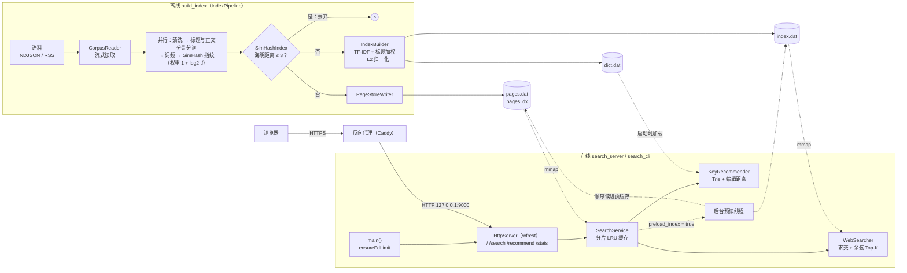
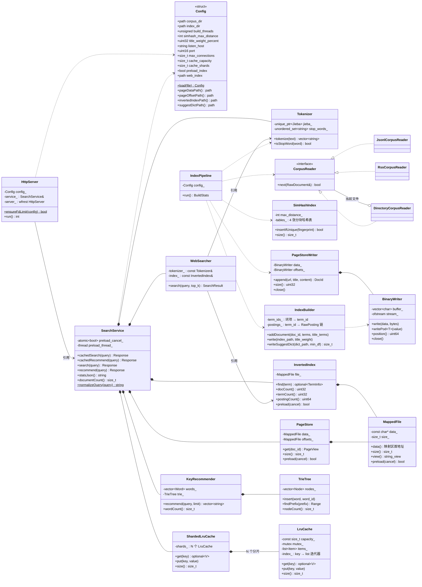
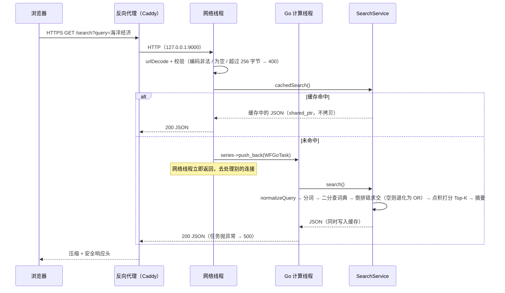

# 架构导读

这份文档回答三个问题：**系统是怎么搭起来的**、**代码应该按什么顺序读**、**踩过哪些坑以及现在为什么这样写**。

文中的数字都有出处：压测类的在 [docs/BENCHMARK.md](docs/BENCHMARK.md)，建库日志和数据质量类的在
[docs/DATA.md](docs/DATA.md)。少数第一阶段在另一台机器上测、没有留下原始记录的数字，会当场标注“无留存”。

---

## 1. 整体架构

### 1.1 一句话概括

离线程序把语料加工成 **4 个只读文件**；在线程序把其中 3 个 `mmap` 进内存、把第 4 个读进一棵 Trie，然后直接查询。
两个程序之间唯一的耦合是磁盘文件格式（`include/search/index/IndexFormat.h`）。



线上的部署形态是最下面那一行：`search_server` 只监听 `127.0.0.1`（`listen_host` 的默认值），
由 systemd 托管（`deploy/search-engine.service`），HTTPS、压缩、安全响应头和访问日志都交给前面的反向代理。

### 1.2 分层与依赖方向

```
apps/      build_index        search_cli          search_server
              │                   │                    │
src/       offline ──────┐     online ◄──────────── server（唯一依赖 wfrest 的目录）
                         ▼        │
                       index ◄────┘        磁盘格式 + 读写
                         │
                       common               配置 / 日志 / UTF-8 / mmap / 分词 / URL 解码

仓库里不参与编译的部分：
web/index.html      单文件前端，由 search_server 的 GET / 原样返回
deploy/             systemd 单元模板
scripts/            语料生成与导入（gen_mock_corpus.py、import_zhwiki.py）、压测（bench/）
docs/               BENCHMARK.md（压测）、DATA.md（建库日志与数据质量）
```

依赖只允许从上往下。`online` 不知道 HTTP 的存在，所以 `search_cli` 和单元测试可以脱离网络直接驱动全部检索逻辑；
`offline` 和 `online` 互不依赖，只通过 `index` 层定义的文件格式对话。

对应到 CMake 是三个 target：`search_core`（common + index + online）、`search_offline`（offline，链接 `search_core`）、
`search_server`（server，找到 workflow 和 wfrest 时才构建）。

### 1.3 类图

成员和方法签名与头文件一致；为了画得下，省略了构造函数、被删除的拷贝操作和部分只读访问器。



`*--` 表示“拥有”（成员对象，生命周期绑定），`-->` 表示“只持有引用”（生命周期由上层保证）。
`Response` 是 `std::shared_ptr<const std::string>`。`JsonlCorpusReader` 等三个实现类定义在 `CorpusReader.cpp` 的匿名
命名空间里，外部只能通过工厂函数 `openCorpusFile()` / `openCorpusDirectory()` 拿到基类指针。
另有两个自由函数不在图里：`computeSimHash(terms)`（`SimHash.h`）和 `cleanHtml(raw)`（`HtmlCleaner.h`）。

整个项目里没有一个裸 `new`/`delete`，也没有全局单例。

### 1.4 磁盘文件格式

| 文件 | 内容 | 在线端用法 |
| --- | --- | --- |
| `pages.dat` | `PageFileHeader`（8 字节）+ 连续的记录：`PageRecordHeader`（12 字节）+ url、title、正文三段字节 | `mmap`，`get()` 返回 `string_view` |
| `pages.idx` | `uint64 offset[doc_count]`，无文件头；文档数 = 文件大小 ÷ 8 | `mmap`，O(1) 定位第 i 篇 |
| `index.dat` | `IndexHeader`（32 字节）→ `TermEntry[]`（按词项字节序升序）→ `Posting[]` → 字符串池 | `mmap`，在词典表上二分查找 |
| `dict.dat` | 文本，每行 `词 总词频`，按词的字节序升序 | 启动时读入并构建 Trie |

定长结构体（定义与 `IndexFormat.h` 逐字段一致；全部小端）：

| 结构体 | 大小 | 字段（按顺序） |
| --- | --- | --- |
| `IndexHeader` | 32 字节 | `uint32 magic`（`0x58444953`，"SIDX"）、`uint32 version`（1）、`uint32 doc_count`、`uint32 term_count`、`uint64 posting_count`、`uint64 string_pool_bytes` |
| `TermEntry` | 24 字节 | `uint64 posting_begin`（在 `Posting[]` 中的起始下标）、`uint32 posting_count`（即文档频率 DF）、`uint32 term_offset`（在字符串池中的偏移）、`uint32 term_length`、`float idf` |
| `Posting` | 8 字节 | `uint32 doc_id`、`float weight`（已含标题加权、已做 L2 归一化）；同一词项内按 `doc_id` 升序 |
| `PageFileHeader` | 8 字节 | `uint32 magic`（`0x47415053`，"SPAG"）、`uint32 version`（1） |
| `PageRecordHeader` | 12 字节 | `uint32 url_length`、`uint32 title_length`、`uint32 content_length` |

- 五个结构体的大小都用 `static_assert` 锁死，前三个还断言了 `is_trivially_copyable`。
- **标题加权不改变文件格式**：它在离线端被折算进 `Posting::weight`，在线端和文件格式版本号都不需要动。
  `IndexBuilder` 内部的 `RawPosting{doc_id, term_frequency:31, in_title:1}` 只存在于建库时的内存里，不落盘。
- 加载时的校验：`index.dat` 检查 magic、版本、各区段大小之和等于文件大小，并逐项检查每个 `TermEntry` 不越界、词项严格升序
  （二分查找的前提）；`pages.idx` 检查大小是 8 的整数倍；`pages.dat` 检查 magic 和版本，每次 `get()` 再检查偏移和三段长度不越界；另外检查两个文件的文档数一致。
  损坏或不匹配的文件在启动时（或那次 `get()`）抛异常，而不是读到映射区之外。
- `pages.dat` 里的记录是紧挨着写的、不保证对齐，所以读 `PageRecordHeader` 和偏移量用 `memcpy`；
  `index.dat` 的各区段都按 8 字节对齐，可以直接把指针转成结构体数组。

### 1.5 一次检索请求的路径

进程启动（`apps/search_server.cpp` 的 `main`）按这个顺序：

1. `Config::load()`；
2. `HttpServer::ensureFdLimit()`：fd 软上限低于 `max_connections + 64` 就用 `setrlimit` 提上去，硬上限也不够则报错退出。
   **必须在第一次用到 Workflow 之前**，原因见 3.3 第 12 条；
3. 构造 `SearchService`：加载分词词典、`mmap` 三个索引文件并校验、读 `dict.dat` 建 Trie；
   如果 `preload_index = true`，在构造函数的最后启动后台预读线程（不阻塞启动）；
4. 构造 `HttpServer`（注册路由、设置 `max_connections`），`run()` 监听 `listen_host:port`，等待 SIGINT / SIGTERM。



- `/recommend` 走完全相同的两条路径，只是计算换成 `KeyRecommender::recommend()`。
- `/stats` 和 `/` 不进计算线程：前者直接在网络线程上返回 `SearchService::statsJson()`（四个启动后不变的计数），
  后者返回 `web_index` 指向的静态文件。
- 打分只是一次点积：标题加权和 L2 归一化都在离线端做完了，`Posting::weight` 拿来就能用。
- `cache_capacity = 0` 时缓存的 `get`/`put` 在加锁之前就返回，所有请求都走“未命中”分支。
- 没有反向代理时（本机调试、`search_cli`），去掉图中的 P 即可；`search_cli` 直接调用 `SearchService`，连 N 和 G 也没有。

### 1.6 规模与实测数据

全部在同一台 4 核 ARM64 服务器上测得（环境见 BENCHMARK.md 第 1 节），建库用 2 个线程。
建库三列的出处是 [docs/DATA.md](docs/DATA.md) 第 1 节的 L1、L4、L5 三次日志。

| 指标 | RSS 样例（仓库自带） | 模拟语料 100 万篇 | 线上索引：Stack Overflow 100 万 + 中文维基 79 万 |
| --- | --- | --- | --- |
| 读入 / 判重丢弃 / 入库 | 4,208 / 267 / 3,941 | 1,000,000 / 46,610 / 953,390 | 1,794,883 / 11,834 / 1,783,049 |
| 词项数 / 倒排记录数 | 9.8 万 / 92 万 | 35 万 / 1.35 亿 | 695 万 / 2.28 亿 |
| 建库耗时（2 线程） | 1.8 s | 241 s | 530 s |
| 建库峰值内存 | — | 1.84 GiB | 3.54 GiB |
| `index.dat` / `pages.dat` | 10.0 MiB / 11.9 MiB | 1.01 GiB / 1.70 GiB | 1.91 GiB / 3.55 GiB |
| 联想词典词条数 | 4.5 万 | 30 万 | 198 万 |

在线部分（线上索引，出处见各行）：

| 指标 | 值 | 出处 |
| --- | --- | --- |
| 启动到开始监听 | 约 4 s，其中约 3 s 是读 198 万词的 `dict.dat` 并建 Trie | DATA.md 第 5 节 |
| 后台预读 5.50 GiB 索引 | 131 s；读完后服务的 cgroup 内存 5.8 GiB | DATA.md 第 5 节 |
| 单次检索（`search_cli`，未命中缓存，索引已在页缓存） | 抽查的 15 条查询为 205 ~ 710 µs | DATA.md 第 4 节 |
| 命中缓存的吞吐（直连，`CPUQuota=200%`） | 3.4 万 QPS | BENCHMARK.md 第 9 节 |
| 经 Caddy（HTTPS）的吞吐 | 4.4 千 QPS，瓶颈在 Caddy | BENCHMARK.md 第 9 节 |

纯英文 100 万篇索引上更完整的压测（基线延迟、三个场景、C10K）见 BENCHMARK.md 第 3~6 节。

几点说明：

- **去重效果（模拟语料）**：100 万篇里注入了 49,765 篇转载，判重丢弃 46,610 篇（召回 93.7%），
  入库数 953,390 ≥ 原创数 950,235，没有误杀。漏掉的是“正文较短 + 末尾追加了署名”的转载，
  海明距离刚好超过阈值 3，这是 SimHash 固有的取舍。
- **去重效果（真实语料）**：线上索引丢弃的 11,834 篇里英文只有 120 篇（抽查是真正的重复提问），
  中文 11,714 篇（占中文的 1.47%），抽样看九成是模板化的小条目。指纹权重从原始词频改成 `1 + log2(tf)` 之前，
  同样的 100 万篇英文会被丢掉 6,229 篇，绝大多数是误杀——经过见 3.3 第 15 条，数据见 DATA.md 第 2 节。
- **SimHash 的局限**：它衡量的是“用词的重合度”。由同一个模板批量生成、只差一两个专有名词的小条目
  （中文维基里的法国市镇、小行星列表分页）用词几乎完全相同，会被判成重复。
  这是算法的正常行为；要保留它们只能调小 `simhash_max_distance`。
- **启动时间**：三个索引文件是 `mmap` 的，不需要“加载”，但启动并不是与数据量完全无关——
  `InvertedIndex` 要把词典表逐项校验一遍、确认词项有序（线上索引的词典表是 695 万 × 24 字节 = 159 MiB），
  `dict.dat` 要整个读入并建 Trie。`mmap` 的代价是冷启动后的第一批查询要等磁盘，
  可以用 `preload_index = true` 在后台预读（BENCHMARK.md 6.5）。
- **建库内存与倒排记录数成正比**（每条 `RawPosting` 8 字节 + vector 扩容余量；2.28 亿条 → 峰值 3.54 GiB）。
  这是当前实现的规模上限所在：千万级文档需要改成“分段落盘 + 多路归并”（SPIMI），见 3.4 节。
- **可复现**：去重和写盘是串行的，所以同一份语料无论用几个线程建库，输出应当逐字节相同。
  这一点在第一阶段的桌面机上用 1 线程和 16 线程验证过（四个文件 SHA-1 一致），在服务器上的旁证是
  同一份语料多次建库的读入、丢弃、词项、posting 数完全一致（DATA.md 第 1 节）。
- **第一阶段的桌面机数字〔无留存〕**：16 线程桌面机上，100 万篇模拟语料建库 124 s，相对单线程的加速比约 3.5 倍
  （读文件、JSON 解析、去重、写盘是串行的）。这两个数没有留下原始日志，只能当量级参考，见 DATA.md 第 6 节。

---

## 2. 代码阅读指南

建议**先跑起来再读**：按 README 构建后执行 `build_index` 和 `search_cli`，对输入输出有了直观印象再看代码。
每个头文件顶部都有一段注释，说明“这个类解决什么问题、原实现错在哪、现在为什么这样设计”——**头文件注释是正文，请不要跳过**。

推荐顺序是自底向上，每一步只依赖前面已经读过的东西。第 0~5 站是 C++ 代码，第 6、7 两站是代码之外、
但让这个项目“能上线、能说清楚自己有多快”的那部分。

每一站末尾有**自测**（合上代码后应该能回答的问题）和一个**重写练习**。单元测试没有用测试框架，
全部在 `tests/unit_tests.cpp` 一个文件里，`./build/unit_tests`（或 `ctest --test-dir build`）会跑完全部 20 个并逐个打印结果；
做重写练习时，把自己的实现换进去，盯着练习里点名的那几个测试即可。

### 第 0 站：建立全局印象（10 分钟）

| 文件 | 看什么 |
| --- | --- |
| `README.md` | 功能、目录、怎么构建和运行 |
| `CMakeLists.txt` | 三个库 target（`search_core`、`search_offline`、`search_server`）谁链接谁——这就是 1.2 节那张依赖图 |
| `conf/search.conf` | 系统有哪些可调参数（每一项都有注释） |
| `apps/build_index.cpp`、`apps/search_cli.cpp`、`apps/search_server.cpp` | 三个 `main()` 都只有十几行，看清程序的“骨架”和对象的创建顺序 |
| `.github/workflows/ci.yml` | CI 实际执行的步骤：构建 → 单元测试 → 建库 → 在线冒烟测试 → fd 上限 → 预读。它是“怎样才算能用”的可执行定义 |

**自测**

1. 离线程序和在线程序之间靠什么耦合？如果要换一种分词器，哪些东西必须重新生成？
2. `search_cli` 为什么不需要链接 wfrest？
3. `search_server` 的 `main()` 里，`ensureFdLimit` 为什么排在构造 `SearchService` 之前？
4. CI 的冒烟测试断言了哪几件事？

**练习**：不看 `apps/search_cli.cpp`，自己写一个只支持“单次查询”的版本（读配置 → 构造 `SearchService` → 调 `search()` → 打印）。
这一站没有对应的单元测试，验证方法是对同一条查询，输出与 `./bin/search_cli conf/search.conf search "海洋经济"` 逐字节相同。

### 第 1 站：公共基础设施 `common/`

| 顺序 | 文件 | 学习点 |
| --- | --- | --- |
| 1 | `Utf8.h` | UTF-8 编码规则；`constexpr`；如何写“对任意脏输入都安全”的解码器（总能前进、绝不越界） |
| 2 | `UrlCodec.h` | 把“可能抛异常的解析”改成返回 `optional`；逐字符校验十六进制 |
| 3 | `Config.h/.cpp` | 强类型配置代替字符串 map；`std::filesystem`；`std::from_chars`；带范围检查的 `number<T>()` 和 `flag()`；fail-fast |
| 4 | `MappedFile.h/.cpp` | **RAII 的标准范例**：Rule of Five、`std::exchange` 实现移动语义；`preload()`：分块 `madvise` + 逐页触碰 + 可取消 |
| 5 | `BinaryWriter.h/.cpp` | 成员声明顺序为什么重要；`static_assert` + `is_trivially_copyable`；为什么必须显式 `close()` |
| 6 | `Tokenizer.h/.cpp` | Pimpl + 前置声明隔离重型头文件；erase-remove 惯用法；`isIndexableToken` 的过滤规则 |
| 7 | `Log.h/.cpp` | 折叠表达式 `(stream << ... << args)`；用一把锁保证一行日志不被打断 |

**自测**

1. `utf8::decodeNext` 遇到被截断的多字节字符时返回什么、`pos` 前进多少？为什么不能前进 0？
2. `urlDecode("%zz")` 和 `urlDecode("%4")` 各返回什么？调用方据此做什么？
3. `MappedFile` 为什么禁止拷贝却允许移动？移动构造之后，源对象的析构函数会做什么？
4. `BinaryWriter` 的 `buffer_` 为什么必须声明在 `stream_` 前面？析构函数里为什么不能代替 `close()` 报告写盘失败？
5. `preload()` 为什么既调 `madvise(MADV_WILLNEED)` 又逐页读一个字节？只留其中一个行不行？（提示：3.3 第 13 条）

**练习**：重写 `MappedFile`（只做 POSIX 分支即可）：构造时 `open` + `fstat` + `mmap`，析构时 `munmap`，支持移动、禁止拷贝，
再实现 `preload(cancel)`。用 `mapped_file_preload` 验证；`page_store_round_trip` 和 `inverted_index_round_trip` 也依赖它，应当一并通过。
热身可以先重写 `Utf8.h` 的 `decodeNext`/`alignForward`/`alignBackward`（`utf8_decode`、`utf8_align`）和 `urlDecode`（`url_decode`）。

### 第 2 站：磁盘格式 `index/`

| 顺序 | 文件 | 学习点 |
| --- | --- | --- |
| 8 | `IndexFormat.h` | **全项目最重要的一个文件**。读懂这五个结构体（对照 1.4 节的表），离线和在线两半就都通了 |
| 9 | `PageStore.h/.cpp` | 长度前缀记录；`string_view` 零拷贝；为什么不对齐的数据要用 `memcpy` 读；读写两端写在同一个文件里 |
| 10 | `InvertedIndex.h/.cpp` | 在 `mmap` 内存上二分查找；加载时的完整性校验（先区段、后逐项）；`std::optional` 做返回值；`PostingList` 只是 `{指针, 长度}` |

**自测**

1. `TermEntry` 的五个字段各是什么？为什么它恰好是 24 字节、`Posting` 恰好是 8 字节？
2. 词项的文本存在哪里？二分查找时比较的是什么？
3. `pages.idx` 没有文件头，在线端怎么知道有多少篇文档？又怎么发现它和 `index.dat` 对不上？
4. 为什么 `index.dat` 可以 `reinterpret_cast` 成结构体数组，而 `pages.dat` 的记录头必须 `memcpy`？
5. 如果有人给 `Posting` 加了一个字段，会在什么时候、以什么方式被发现？

**练习**：重写 `PageStoreWriter::append` 和 `PageStore::get`（含越界检查），用 `page_store_round_trip` 验证；
再重写 `InvertedIndex` 的构造函数（全部校验）和 `find()`，用 `inverted_index_round_trip` 验证——这个测试的最后一段会喂一个损坏的文件，
期望构造函数抛异常。
另外两个测试专门构造“看起来合法但其实坏了”的文件：`page_store_rejects_truncated_offsets`（偏移库被截断）
和 `inverted_index_rejects_unsorted_terms`（词典表乱序）。

### 第 3 站：离线管线 `offline/`

| 顺序 | 文件 | 学习点 |
| --- | --- | --- |
| 11 | `Document.h` | 用排序 vector 代替 `std::map` 统计词频（`countTermFrequencies` 接收右值，全程移动） |
| 12 | `CorpusReader.h/.cpp` | 抽象基类 + 工厂函数 + `unique_ptr`；流式（拉模式）迭代器；按扩展名识别格式；目录递归不进入符号链接目录 |
| 13 | `HtmlCleaner.h/.cpp` | 手写单趟状态机，替换掉 `std::regex`；HTML 实体解码的长度上限 |
| 14 | `SimHash.h/.cpp` | SimHash 原理；**为什么权重是 `1 + log2(tf)` 而不是 `tf`**；用整数计票保证跨机器结果一致；**抽屉原理把 O(N²) 判重降到近似 O(N)**（面试高频） |
| 15 | `IndexBuilder.h/.cpp` | TF-IDF 与 L2 归一化；**标题加权为什么与模长成比例**（头文件注释里有完整推导）；`try_emplace`；位域 `RawPosting`；内存布局对构建规模的影响 |
| 16 | `IndexPipeline.h/.cpp` | 把前面所有零件串起来：读一批（串行）→ 清洗分词指纹（并行）→ 去重写盘（串行）；`parallelFor`：原子计数器抢任务、异常跨线程传递 |
| 17 | `scripts/gen_mock_corpus.py` | 模拟语料是怎么生成的、转载是怎么注入的——读懂它才知道 1.6 节“召回 93.7%”的分母是什么 |

**自测**

1. 海明距离阈值为 3 时，为什么把 64 位指纹切成 4 块就能保证不漏判？阈值改成 4 要切几块？
2. 两篇无关的短文都含 30 个 "0"，为什么按原始词频加权会被判成重复？换成 `1 + log2(tf)` 后这个词的权重从多少变成多少？
3. 一篇文档里某个词的最终权重（写进 `Posting::weight` 的值）是怎么一步步算出来的？标题里的词多了哪一项？
4. 为什么“标题词频 ×10”几乎无效，而“加上模长的 100%”有效？
5. 管线的三个阶段里哪些是并行的？为什么去重不并行？这带来了什么可验证的性质？

**练习**：重写 `SimHashIndex::insertIfUnique`（分块索引）。`simhash_index_matches_brute_force` 会拿一个 O(N²) 的暴力实现逐条对拍，
两者对每一个指纹的判断必须一致。再重写 `computeSimHash`，用 `simhash_fingerprint` 和
`simhash_not_dominated_by_one_frequent_term` 验证（后者正是自测第 2 题的场景）。
进阶：重写 `IndexBuilder::write` 的权重计算，用 `index_builder_title_weight` 和 `inverted_index_round_trip` 验证。
其它相关测试：`html_cleaner`、`term_frequencies`。`CorpusReader` 和 `IndexPipeline` 没有单元测试，
它们靠 CI 的“Offline build”一步覆盖（建库后的冒烟查询能搜到东西）。

读完这一站，建议自己动手把 `apps/build_index` 复现一遍。

### 第 4 站：在线检索 `online/`

| 顺序 | 文件 | 学习点 |
| --- | --- | --- |
| 18 | `LRUCache.h` | `list::splice` 实现 O(1) LRU；哈希分片降低锁竞争；模板类写在头文件；容量 0 时在加锁之前返回 |
| 19 | `TrieTree.h/.cpp` | 用“有序区间”代替每个节点的 `set<int>`；vector 下标代替裸指针；迭代器/引用失效 |
| 20 | `KeyRecommender.h/.cpp` | 两级联想：前缀补全 → 回退前缀 + 编辑距离纠错；滚动数组编辑距离；固定容量 Top-K 堆；候选数上限保护延迟 |
| 21 | `WebSearcher.h/.cpp` | 多路有序链求交（游标 + 二分）；AND 为空时退化为 OR；查询向量归一化；`partial_sort`；严格弱序 |
| 22 | `SearchService.h/.cpp` | Facade；依赖注入代替单例；成员声明顺序即构造顺序；`shared_ptr<const T>` 共享只读数据；`normalizeQuery`；摘要生成；`statsJson()`；带取消标志的后台预读线程 |

**自测**

1. `LruCache::get` 命中时做了哪两件事？为什么 `splice` 不会让 `index_` 里存的迭代器失效？
2. 为什么 Trie 的每个节点只存 `[begin, end)` 两个数就够了？这依赖词典的什么性质？
3. 用户输入 "pyhton"，联想是怎么找到 "python" 的？为什么回退前缀的候选超过 4096 个就放弃纠错？
4. 三个词的查询，`intersect` 以哪条倒排链为驱动？其它链上的游标为什么可以只进不退？
5. `SearchService` 的 `preload_thread_` 为什么必须声明在最后？析构函数里为什么要先置 `preload_cancel_` 再 `join`？

**练习**：重写 `LruCache` 和 `ShardedLruCache`。用 `lru_cache_eviction`（淘汰顺序）、`lru_cache_zero_capacity_is_disabled`
和 `sharded_lru_cache_concurrency`（多线程读写，最好在 `-fsanitize=thread` 下再跑一遍）验证。
再重写 `TrieTree`（`trie_prefix_range`）和 `editDistance` + `KeyRecommender::recommend`（`edit_distance`、`key_recommender`）。
`WebSearcher` 和 `SearchService` 目前**没有单元测试**；重写 `intersect` 的话，验证方法是对一批查询比较
`search_cli` 的输出与原实现逐字节相同（可以用 `scripts/bench/queries.txt` 的前几百条）。

### 第 5 站：HTTP 接入 `server/` 与前端

| 顺序 | 文件 | 学习点 |
| --- | --- | --- |
| 23 | `HttpServer.h/.cpp` | Workflow 的 series/任务模型；网络线程与计算线程分离；lambda init-capture；异常不能逃出任务函数；`ensureFdLimit`（`getrlimit`/`setrlimit`）；信号处理函数里只做异步信号安全的事；优雅退出 |
| 24 | `apps/search_server.cpp` | 启动顺序：配置 → fd 上限 → 服务 → 监听 |
| 25 | `web/index.html` | 单文件前端。重点看两处：**所有接口返回的文本只经 `textContent` / `createTextNode` 进入 DOM**；高亮是“先在纯文本上找区间、再逐段建节点”，不是在 HTML 字符串上替换 |

**自测**

1. 一个未命中缓存的请求，在哪个线程解析参数、在哪个线程做检索？`response` 指针在计算线程里为什么仍然有效？
2. Go 任务里如果不 `catch` 异常会怎样？
3. fd 软上限 1024、`max_connections = 5000` 时服务会怎么做？硬上限也只有 1024 呢？为什么不是只打一条告警？
4. `/stats` 为什么可以直接在网络线程上应答，而 `/search` 不行？
5. 摘要里含有 `<script>alert(1)</script>` 时，前端为什么不会执行它？如果把高亮改成“在转义后的 HTML 上做字符串替换”，会引入什么风险？

**练习**：重写 `HttpServer::handleQuery`（参数校验 → 查缓存 → 未命中则投递 Go 任务）。这一层没有单元测试，
用 CI 的“Online smoke test”里那几条 `curl` 验证：正常查询返回数组、`%zz` 和缺参数返回 400、服务只监听 127.0.0.1；
再用“fd limit handling”那一步验证 `ensureFdLimit`（软上限不够自动提高，硬上限不够拒绝启动）。

### 第 6 站：部署与运维

| 顺序 | 文件 | 看什么 |
| --- | --- | --- |
| 26 | `conf/search.conf` 的“在线服务”一段 | `listen_host`、`port`、`max_connections`、`cache_capacity`/`cache_shards`、`preload_index` 各自的含义和默认值 |
| 27 | `deploy/search-engine.service` | systemd 单元模板：`Restart=on-failure`、`LimitNOFILE`、`CPUQuota`、`MemoryHigh`/`MemoryMax`，以及一组沙箱选项（`ProtectSystem=strict`、`NoNewPrivileges`…）。**内存上限的注释要读**：`mmap` 的索引计入本服务的 cgroup |
| 28 | `README.md` 的“部署与高并发” | 三道连接数上限、冷启动与预读、反向代理 |
| 29 | `docs/BENCHMARK.md` 第 5 节和第 9 节 | 连接数上限配错时的真实表现；经反向代理后的吞吐 |

线上的反向代理是 Caddy，站点配置不在仓库里（它属于服务器，而不是这个项目），要点是：
`reverse_proxy 127.0.0.1:9000`、`encode zstd gzip`、HSTS / `X-Content-Type-Options` / `Referrer-Policy` /
`X-Robots-Tag: noindex`，以及一条与单文件前端匹配的 CSP：
`default-src 'none'; script-src 'unsafe-inline'; style-src 'unsafe-inline'; connect-src 'self'; ...`
（前端不引用任何外部资源，所以可以默认全部禁止）。

**自测**

1. 为什么服务默认只监听 127.0.0.1？直接把 9000 端口开到公网会少掉哪些东西？
2. 线上索引 5.5 GiB、进程自身内存约 0.4 GiB，`MemoryMax=6G` 够不够？为什么？`MemoryHigh` 和 `MemoryMax` 的区别是什么？
3. 重启服务后的头两分钟，查询延迟会是什么样？应该怎么安排流量？
4. `ProtectSystem=strict` 之后服务还能写哪里？日志去了哪儿？
5. 把 `max_connections` 调到 20000，还要同时确认哪两处？各自配错时的现象是什么？

**练习**：在自己的机器上按模板部署一遍：改路径和用户 → `systemctl enable --now` → 用 `systemctl status` 和
`journalctl -u search-engine` 确认启动日志里有 `listening on http://127.0.0.1:9000` → 故意把 `LimitNOFILE` 改成 1024、
`max_connections` 改成 5000，确认服务拒绝启动且日志里说明了原因。这一站没有单元测试，对应的自动化检查是 CI 的
“fd limit handling”和“Index preload”两步。

### 第 7 站：压测与数据

| 顺序 | 文件 | 看什么 |
| --- | --- | --- |
| 30 | `scripts/bench/gen_queries.py`、`queries.txt` | 查询集怎么来的（蓄水池抽样、固定种子）；它只有 4,741 条不同查询——这个事实决定了“场景 C”测到的是什么 |
| 31 | `scripts/bench/search.lua`、`recommend.lua` | wrk 的线程模型（每线程一个 Lua 虚拟机）；怎样在脚本里统计非 2xx；请求报文预先拼好 |
| 32 | `scripts/bench/run_bench.sh` | 各个阶段；绑核；页缓存预热；每轮同时采样 CPU、RSS、fd 数、accept 队列 |
| 33 | `scripts/bench/cold_start.py` | 用 `posix_fadvise(DONTNEED)` + `mincore()` 做**只影响这几个文件**的冷启动实验，而不是全机 `drop_caches` |
| 34 | `docs/BENCHMARK.md` | 先读“结论速览”和第 8 节“测试的局限性”，再读中间的表 |
| 35 | `scripts/import_zhwiki.py` | parquet → NDJSON；繁转简为什么用 `t2s` + 一张小词表而不是 `tw2sp`（脚本开头的注释） |
| 36 | `docs/DATA.md` | 建库日志、SimHash 误判的诊断数据、标题加权的扫参表 |

**自测**

1. 场景 A、B、C 各自测的是什么？为什么说场景 C “实际上等同于场景 A”？
2. 命中缓存时 2 个核约 3.7 万 QPS，瓶颈是什么？凭什么说不是缓存锁？
3. wrk 是闭环压测，这对测到的延迟意味着什么？C10K 表里 p50 ≈ 连接数 ÷ QPS 说明了什么？
4. fd 上限不够时，为什么 wrk 报告 0 错误？当时是靠哪两个指标发现问题的？
5. 经 Caddy 之后吞吐降到直连的 13%，怎么判断瓶颈在 Caddy 而不在检索服务？

**练习**：在自己的机器上重跑 `scripts/bench/run_bench.sh baseline scale-a scale-b`，对照 BENCHMARK.md 第 3、4 节
解释每一处差异（核数、磁盘、是否同机）。然后做 3.4 节的“部分命中的压测”——那是现有压测明确承认没有覆盖的场景。
这一站没有单元测试；压测脚本的正确性靠 `results.tsv` 里的“错误数”和“非 2xx”两列为 0 来保证。

### 最后：`tests/unit_tests.cpp`

每个测试都是对应模块的“可执行文档”。自己复现某个模块时，先让对应的测试失败，再写实现让它通过，
是验证自己是否真的理解了的最快办法。`simhash_index_matches_brute_force` 展示了如何用暴力解法验证优化解法。

目前**没有单元测试覆盖**的部分：`Config`、`Tokenizer`、`CorpusReader`、`IndexPipeline`、`WebSearcher`、`SearchService`、
`HttpServer`。它们由 CI 里的建库和冒烟测试端到端覆盖；给 `WebSearcher` 补单元测试是一个很好的入门练习（见 3.4）。

---

## 3. 常见问题与避坑指南

### 3.1 原代码中发现的问题

按严重程度分组。“位置”指原 `main` 分支中的文件。

#### A. 会导致崩溃或可被远程利用

| # | 问题 | 位置 | 后果 | 现在的做法 |
| --- | --- | --- | --- | --- |
| A1 | `uriDecode` 用 `std::stoi(hex, nullptr, 16)`，不校验输入 | `NetServer.cpp` | 请求 `/search?query=%zz` 即抛异常，异常逃出回调，**进程终止** | `urlDecode` 逐字符校验，返回 `optional`，非法输入 → 400 |
| A2 | 编辑距离用变长数组 `int dp[n+1][m+1]`，n 来自用户输入 | `KeyRecommend.cpp` | 超长 query **栈溢出**；VLA 本身也不是标准 C++ | 堆上的滚动数组，且 query 截断到 32 字符、256 字节 |
| A3 | `elem->GetText()` 可能返回 `nullptr`，直接赋给 `std::string` | `PageLib.cpp` | 遇到空标签 `<title/>` 即未定义行为（通常崩溃） | `childText()` 判空 |
| A4 | 特化 `std::less<pair<int,double>>` 等标准库类型 | `WebSearch.h`、`KeyRecommend.h` | 未定义行为；且比较器对相等元素返回 `true`，违反严格弱序 | 用 lambda 比较器，得分相同按 id 决胜 |
| A5 | 对查询串、JSON 输出、索引文件都没有任何长度/合法性校验 | 多处 | 脏语料里一个非法 UTF-8 字节就让 `json.dump()` 抛异常 | 查询限长；`dump` 用 `replace` 策略；索引加载时全量越界检查 |

#### B. 逻辑错误（结果不对）

| # | 问题 | 位置 | 现在的做法 |
| --- | --- | --- | --- |
| B1 | 偏移库**写入**的是 `{起始, 结束}`，**读取**时按 `{起始, 长度}` 解释；去重后的库又写成 `长度-1` | `PageLib.cpp` / `PageLibPreprocessor.cpp` | 只存起始偏移，长度写在记录头里，读写两端共用 `IndexFormat.h` |
| B2 | SimHash 只取 top-10 关键词算指纹，粒度太粗：4125 篇被“去重”成 1958 篇，**一半是误杀**（语料中不同的正文实际约 4040 篇） | `WebPage.cpp` | 用全部词项、按次线性词频 `1 + log2(tf)` 加权；同一语料现在 4208 → 3941 |
| B3 | 查询向量的 IDF 用写死的 `N=1, DF=1` 计算，所有词权重相同 | `WebSearch.cpp` | IDF 存进索引，查询端使用真实 IDF |
| B4 | “余弦相似度”只在查询词维度上重新计算文档模长：单词查询时所有文档得分都是 1 | `WebSearch.cpp` | 文档权重离线时已按整篇归一化，点积即余弦 |
| B5 | 伪 XML 存储靠 `find("</content>")` 解析，正文含该串就错位；内容也没有转义 | `WebPage.cpp` | 长度前缀的二进制记录，不需要任何转义 |
| B6 | 偏移量用 `int`，网页库超过 2GB 即溢出 | 多处 | `uint64_t` |
| B7 | 多词查询只要有一个词不在索引里，交集就是空的，整体无结果（搜一句话基本搜不到东西） | `WebSearch.cpp` | AND 无结果时退化为 OR |
| B8 | `main` 出错后仍 `return 0`；`printf("%ld", size_t)` | `offline/main.cpp` 等 | 返回 `EXIT_FAILURE`；类型安全的日志 |
| B9 | 离线 `main` 根本没有调用 `DictProducer`，联想词典依赖仓库里一份不知何时生成的旧文件 | `offline/main.cpp` | 词典由建库管线从同一份语料统一产出，保证“能联想到的词一定搜得到” |

#### C. 性能问题

| # | 问题 | 位置 | 复杂度变化 |
| --- | --- | --- | --- |
| C1 | `auto lib = getInvertIndexLib();` 少写一个 `&`：**每次查询深拷贝整个倒排索引两遍**，外加偏移库、词典各一遍 | `WebSearch.cpp`、`KeyRecommend.cpp` | O(索引大小) → O(1) |
| C2 | 判重时与已有全部指纹逐一比较 | `PageLibPreprocessor.cpp` | O(N²) → 近似 O(N) |
| C3 | `storeIntoInvertIndexLib()` 被放进逐文档循环里 | `PageLibPreprocessor.cpp` | 每篇文档重写一次索引文件 → 只写一次 |
| C4 | Trie 每个节点一个 `set<int>` 存所有经过它的词；查询按值返回整个 set | `TrieTree.cpp` | 内存 O(总字符数) 个树节点 → 每节点 8 字节区间 |
| C5 | 每清洗一个字段现场构造并执行 2 个 `std::regex` | `WebPage.cpp`、`PageLib.cpp` | 手写单趟扫描 |
| C6 | 索引是文本格式，启动时逐行 `istringstream` 解析进嵌套 `unordered_map` | `Dictionary.cpp` | 启动 O(索引大小) 解析 → `mmap` 即用 |
| C7 | 每篇文档被 jieba 切两次；语料被完整读写磁盘三遍；全部网页先读进内存 | 离线全流程 | 单趟流式，分词一次，并行 |
| C8 | 求交集用 `set<int>` 反复构造/转换；每次查询重新 `open` 网页库文件 | `WebSearch.cpp` | 有序数组上的游标二分；`mmap` 常驻 |
| C9 | 在 `vector` 上循环 `erase(it)` 过滤停用词 | `WebSearch.cpp` | O(n²) → erase-remove O(n) |
| C10 | jieba 词典被加载两份（分词器一份、Simhasher 内部一份） | 离线 | 只加载一份 |

#### D. 设计与工程规范

- **全局单例泛滥**：`Configuration`、`Dictionary` 被所有类在任意位置 `getInstance()`，依赖关系不可见、无法单测；
  `SplitToolCppJieba` 的构造函数里甚至写死了 `"../conf/myconf.conf"`，导致程序只能在 `bin/` 目录下启动。
- **裸指针与泄漏**：`Dictionary` 里 `new SplitToolCppJieba()` 从不释放；Trie 手写递归 `delete`。
- **头文件污染**：头文件里 `using std::string;`、`using namespace wfrest;`，以及把十几个无关头文件 include 进来。
- **状态放错位置**：`WebSearch`/`KeyRecommend` 把“一次查询的中间结果”存在成员变量里，对象不可重入。
- **仓库卫生**：`bin/`、`build/`、`.vscode/`、生成的 `*.dat` 全部入库；第三方库放在 `include/` 下与业务头文件混在一起。

### 3.2 核心设计考量

前六条是重构时定下的，后四条是后面几个阶段用数据换来的。

**1）为什么选 `mmap` + 定长二进制布局，而不是“启动时读进内存”？**
线上索引有 2.28 亿条 posting。读进 `unordered_map` 意味着上亿次 `malloc` 和很长的启动时间；
而定长数组 `mmap` 之后，“加载”只是建立页表映射，实际数据由内核按需换入，并且天然可被所有线程无锁共享。
代价有两个：文件格式与机器字节序绑定（小端）；冷启动后的第一批查询要等磁盘（第 7 条）。

**2）为什么不要单例？**
单例的问题不在“只有一个实例”，而在“谁都能随手拿到”。重构后只有 `main()` 创建对象，
并通过构造函数把依赖一层层传下去：`Config → SearchService → WebSearcher`。
好处是任何一个类都可以在测试里单独构造（见 `unit_tests.cpp` 里直接构造一个 `KeyRecommender`）。

**3）“零拷贝”具体落在哪里？**
- 网页正文：`PageStore::get()` 返回指向映射内存的 `string_view`，直到生成摘要才拷贝那 300 字节；
- 倒排链：`PostingList` 只是 `{指针, 长度}`；
- 响应体：`shared_ptr<const string>` 在缓存与发送线程之间共享，命中缓存时不复制 JSON；
- 离线：`countTermFrequencies(vector<string>&&)` 全程移动而不是拷贝。

**4）线程安全是怎么保证的？**
原则是**尽量不共享可变状态**，而不是到处加锁：
- 在线：构造完成后所有数据只读；可变的只有缓存（锁被限制在单个分片内，持锁时间只有几次指针操作）
  和预读线程（它只读索引，与查询线程之间唯一的共享变量是一个 `atomic<bool>` 取消标志）；
- 离线：并行阶段每个线程只写自己的输出槽位；有顺序要求的去重和写盘放在单线程阶段。

**5）为什么去重和写盘不并行？**
SimHash 判重依赖“先来后到”，并行会让结果随线程调度变化。保持串行换来的是**可复现**：
同一份语料无论用几个线程，产出的文件逐字节相同。为了不破坏这一点，指纹的计票用的是整数而不是浮点
（浮点加法的结果与累加顺序、编译选项有关）。

**6）哪些地方故意没有做（避免过度设计）？**
- 没有做索引压缩（VByte/PForDelta）、跳表、WAND 动态剪枝——百万级用不上，却会让代码难读数倍；
- 没有做增量索引/段合并——当前是全量重建，简单可靠；
- 没有引入日志库、测试框架、依赖注入框架——各用几十行手写代码解决；
- 缓存没有做 TTL 和防击穿（single-flight）——并发未命中时会重复计算一次，结果一致，可以接受；
- 打分没有换成 BM25——标题加权只是对“余弦相似度偏爱短文档”的最小修正（第 9 条）。

这些都是不错的“下一步练手题”，见 3.4。

**7）预读为什么放在后台线程，而不是启动时读完再监听？**
线上索引读一遍要 131 秒（DATA.md 第 5 节）。同步读意味着重启后两分多钟不可用，也没法被 systemd 判断为“已启动”；
放在后台则服务 4 秒就绪，预读期间照常应答，只是还没读到的部分仍会缺页。
代价是预读进行中的查询要和它抢磁盘，反而比不预读更慢（BENCHMARK.md 6.5：前 20 条 p50 从 333 ms 变成 777 ms），
所以重启后的头一两分钟最好不要把流量切过来。线程带一个取消标志，进程退出时不用等它读完。

**8）fd 上限不够时为什么是“拒绝启动”，而不是打一条告警？**
因为这种故障在运行时是无声的（3.3 第 12 条）：客户端不报错、服务没有日志。
启动失败立刻能看到，而无声卡住要到线上高峰才暴露。原则：**能在启动时发现的配置错误，就不要留到运行时**。
同样的思路也用在索引文件上——损坏或版本不匹配的文件在加载时被拒绝。

**9）标题加权为什么做在离线端、折算进 `Posting::weight`？**
在线端的打分循环是最热的代码，它现在只是一次点积。把标题信息带到在线端（多一个字段、多一次判断）
会让每条 posting 变大、让热循环变慢，还要改文件格式；而“这个词在不在标题里”在建库时就完全确定了。
代价是调 `title_weight_percent` 要重建索引（线上索引约 9 分钟）。

**10）为什么对外只暴露反向代理？**
`search_server` 只会说明文 HTTP，不做 TLS、压缩、限流和访问日志——这些交给 Caddy/Nginx，是成熟且与业务无关的东西。
所以 `listen_host` 默认是 `127.0.0.1`。代价见 3.3 第 17 条：这一层比检索本身贵。

### 3.3 踩过的坑

前 11 条是写 C++ 时的通用陷阱，一两句话能说清。第 12~17 条是后面几个阶段在真实数据和真实部署上踩到的，
按“现象 → 怎么发现的 → 根因 → 怎么修的 → 数据”展开。

1. **`auto` 不会推导出引用。** `auto x = obj.getBigThing();` 是拷贝，要写 `const auto& x`。这是原代码最大的性能问题（C1）的根源。
2. **成员按声明顺序构造，与初始化列表的书写顺序无关。** `BinaryWriter` 的缓冲区必须声明在 `ofstream` 前面；
   `SearchService` 里 `searcher_` 必须声明在它引用的 `tokenizer_`、`index_` 后面，预读线程必须声明在最后。开 `-Wall` 能发现写反的情况。
3. **`vector` 扩容会让所有引用和迭代器失效。** `TrieTree::insert` 里先取了 `nodes_[i]` 的引用再 `emplace_back` 就是悬垂引用——所以那里全程只用下标。
4. **range-for 不延长“临时对象的成员”的生命周期。** `for (auto& p : index.find(t)->postings)` 在 C++17 里是悬垂引用，
   重构时的测试代码里就真实踩到了（编译器 `-Wdangling-pointer` 报了出来）。
5. **析构函数里不能报告错误。** 写文件必须显式 `close()` 并检查，否则磁盘写满时你得到的是一个静默损坏的索引。
6. **异常不能跨线程传播。** 工作线程里的异常必须用 `exception_ptr` 捕获后带回主线程，否则直接 `std::terminate`；
   同理，Workflow 的 Go 任务里必须 `catch` 住所有异常并转成 500。
7. **`string_view` 不拥有内存。** 它指向的 `MappedFile`/`std::string` 必须活得比它久；跨线程、进缓存的数据一定要转成 `std::string`。
8. **离线和在线必须用同一套归一化。** 大小写、停用词、标点过滤只要有一处不一致，就会出现“明明在索引里却搜不到”。所以这些逻辑只存在于 `Tokenizer` 一处。
   语料也一样：中文维基是繁简混排，而分词词典是简体，不先统一转成简体的话，繁体条目用简体查询搜不到（`scripts/import_zhwiki.py`）。
9. **UTF-8 不能按字节处理。** 截断摘要、计算编辑距离、Trie 的边，都要在“字符”层面操作；面对脏数据，解码器必须保证总能前进且不越界。
10. **比较器必须是严格弱序。** `comp(a, a)` 必须为 `false`；想要稳定可复现的 Top-K，就给相等的情况加一个决胜字段。
11. **Windows 上注意换行符。** 词典/语料一旦被 Git 转成 CRLF，分词结果里就会混进 `\r`。仓库用 `.gitattributes` 强制 LF。

#### 12. fd 上限不够：连接无声地卡在 accept 队列里

- **现象**：压测 5,000 个并发连接，wrk 报告 0 错误，服务日志没有任何输出，QPS 看起来也正常（2.9 万）。
- **怎么发现的**：两个旁证。一是 p50 停在 34 ms，和 1,000 连接时一样——按闭环压测的规律它应该随连接数增长；
  二是压测中途采样 `/proc/<pid>/fd` 的条目数停在 1,024，监听 socket 的 Recv-Q 是 3,997。
  第一次测的时候 wrk 自己也是 `ulimit -n 1024`，先撞墙的是客户端，掩盖了服务端的问题；把客户端的上限放开后才看到。
- **根因**：每个连接占一个 fd。进程的 fd 用完后 `accept()` 一直失败（EMFILE），而内核已经替它完成了三次握手，
  这些连接就停在 accept 队列里，既不被服务也不被拒绝。当时的版本只在启动时打一条告警（fd 上限低于 max_connections），之后就再没有任何输出。
- **怎么修的**：`HttpServer::ensureFdLimit()`，在 `main` 的最开头调用。软上限低于 `max_connections + 64` 就用 `setrlimit` 提上去；
  硬上限也不够就打印原因并以非 0 退出码拒绝启动。必须早于第一次使用 Workflow：它初始化 poller 时按“当时的”软上限分配内部的 fd 表，
  之后再提高，超出旧上限的 fd 它仍然管不了。
- **数据**（BENCHMARK.md 第 5 节 ②、③ 组及该节的“后续改动”）：

  | 连接数 | 修复前：卡在 accept 队列的连接 | 其它现象 |
  | --- | --- | --- |
  | 2,000 | 997 | wrk 0 错误 |
  | 5,000 | 3,997 | wrk 0 错误 |
  | 10,000 | 队列满（4,097） | 内核 30 秒丢弃 146,735 次，wrk 出现 44,100 个 write 错误 |

  修复后：软上限 1024、`max_connections = 5000` 时服务把软上限提到 5,064；3,000 个并发连接下服务端 fd 3,021、accept 队列 0、零错误。
  另一道闸 `max_connections` 的失败方式不同：超出的连接被接受后立刻关闭，客户端看得到错误，但重连风暴会把吞吐拖到正常值的 1/5
  （10,000 连接时 6,972 QPS 对 3.3 万）。
- **教训**：C10K 的瓶颈往往不在代码里，而在“上限”上（框架的 `max_connections`、进程的 fd 上限、内核的 `somaxconn`）；
  **读压测结果不能只看错误数是不是 0**。

#### 13. `madvise(MADV_WILLNEED)` 不会预读整个大文件

- **现象**：预读的第一版实现是对整个映射调用一次 `madvise(MADV_WILLNEED)`。调用立刻返回、不报错，但冷启动后的查询一点没变快。
- **怎么发现的**：没有相信“调用成功”，而是用 `mincore()` 实际去量文件有多少页在页缓存里：
  495 MiB 的 `index.dat` 调用之后驻留比例是 0.8%（4 MiB），等 8 秒也不再增长。
- **根因**：Linux 把单次预读量封顶在块设备的 max(`read_ahead_kb`, `max_sectors_kb`)，这台机器上是 2,048 和 4,096 KB。
  `WILLNEED` 是“建议”，被打了折扣不会告诉你。
- **怎么修的**：`MappedFile::preload()` 按 1 MiB 分块，每块先 `madvise` 再逐页读一个字节，每块之间检查取消标志；
  由 `SearchService` 在构造函数末尾启动的后台线程执行（先读 `index.dat`，再读网页库）。
  试过的中间方案是按 256 KiB 分块只调 `madvise`：能读进 100%，但调用本身阻塞了 8.8 秒，所以必须放到后台。
- **数据**（BENCHMARK.md 6.5，1,730 MiB 的纯英文索引；每轮先用 `posix_fadvise(DONTNEED)` 把索引逐出页缓存）：

  | 配置 | 前 20 条未命中查询的 p50 | 300 条查完 |
  | --- | --- | --- |
  | 不预读 | 332.5 ms | 29.1 s |
  | 预读，就绪后立刻查询 | 776.7 ms | 33.7 s |
  | 预读，等读完（33.6 s）再查询 | 0.50 ms | 0.28 s |

  线上的 5.50 GiB 索引预读用了 131 秒（DATA.md 第 5 节）。
- **教训**：**“建议类”的系统调用一定要测效果**；做冷启动实验不需要全机 `drop_caches`，
  `posix_fadvise(DONTNEED)` + `mincore()` 可以只动自己的文件（`scripts/bench/cold_start.py`）。

#### 14. 服务默认只监听 127.0.0.1

重构后的第一版 `server_.start(port)` 监听的是所有网卡，在一台有公网 IP 的机器上一启动就对外暴露了。
现在 `listen_host` 默认是 `127.0.0.1`，CI 的冒烟测试会用 `ss -ltn` 断言监听地址不是 `0.0.0.0`。对外访问交给反向代理。

#### 15. SimHash 的两次修复

**第一次（重构时）：只取 top-10 关键词，粒度太粗。**

- **现象**：原实现把 RSS 样例的 4,125 篇“去重”成 1,958 篇，丢了一半以上。
- **怎么发现的**：统计语料里互不相同的正文，约有 4,040 篇——被丢掉的大部分根本不是重复。
- **根因**：指纹只由 TF-IDF 最高的 10 个关键词决定。同一个栏目的新闻关键词高度重合，10 个词不足以区分它们。
- **怎么修的**：用文档的**全部词项**、按词频加权计算指纹（自己实现的 `computeSimHash`，不再依赖第三方的 Simhasher）。
- **数据**：同一份语料入库 3,923 篇。（“4,125 → 1,958”和“约 4,040”是重构时的记录，即 3.1 节的 B2，没有留存原始日志；
  3,923 见 DATA.md 2.2。）

**第二次（接入真实语料后）：按原始词频加权，指纹被一个高频词“绑架”。**

- **现象**：中文维基接进来之后，建库日志里的判重丢弃数偏高（120 万篇丢 11,115 篇）。模拟语料上一切正常。
- **怎么发现的**：把“被丢弃的文档”和“它匹配到的那篇”成对导出来人工看。有 107 篇中文条目匹配到的是**英文的 Stack Overflow 提问**：
  足球运动员“山田泰宽”与一篇 R 语言提问的海明距离是 1。逐对比较词频后发现共同点：双方都有一个出现几十次的词
  （成绩表里的 "0"、演员表里的“饰”、年表里的“年”），它占全文词频的比例在无关配对里中位数是 12.4%、最高到 54%（全体文档的中位数是 5.4%）。
  而且不限于短文档：“美国国家科学院”（375 个词项）与“6月28日”（1,063 个词项）也因为“年”字被判重。
- **根因**：指纹的每一位是所有词按权重投票的结果。权重等于词频时，一个出现 30 次的词有 30 票，
  其余几十个各出现一两次的词加起来也压不过它——指纹几乎就是这一个词的哈希。
- **怎么修的**：权重改成次线性的 `1 + log2(tf)`（出现 30 次的词从 30 票降到约 5.9 票），放大 256 倍取整后用整数计票。
  同时评估并排除了另外两个方案：`sqrt(tf)`（转载召回更低），以及“短文档只做精确去重”（治标：长文档同样中招，而且无关配对反而更多）。
- **数据**（DATA.md 第 2 节，同一份 120 万篇语料）：

  | 指标 | 原始词频 | `1 + log2(tf)` |
  | --- | --- | --- |
  | 英文 100 万篇丢弃 | 6,229 | 120（抽查是真正的重复提问） |
  | 中文 20 万篇丢弃 | 4,886 | 1,759 |
  | 中文匹配到英文文档 | 107 | 0 |
  | 抽样 400 对中“无关”的比例 | 24.0% | 0% |
  | 模拟语料 1,010 篇转载的丢弃数 | 982（97.2%） | 945（93.6%） |

  代价是转载召回降了约 3.6 个百分点。剩下被丢弃的中文条目九成是模板化的小条目，这是 SimHash 的固有局限（1.6 节）。
  回归测试：`simhash_not_dominated_by_one_frequent_term`。
- **教训**：**模拟语料测不出这类问题**——随机生成的文本里没有“一个词占全文三成”的文档。
  去重这类“默默丢数据”的环节，一定要用真实数据抽查被丢弃的样本，而不是只看丢弃数是否“看起来合理”。

#### 16. 标题加权：第一个方案被数据否定

- **现象**：在线上索引上搜“红楼梦”，《红楼梦》主条目排第 6，排第 1 的是一篇 667 字的红学家条目；
  搜“人工智能”主条目排第 8，“第二次世界大战”主条目不在前 10。
- **怎么发现的**：建完中英混合索引后，按一份固定的查询清单逐条人工看结果。
- **根因**：文档向量按 L2 归一化，文档越长、维度越多，每个词分到的权重越小——余弦相似度偏爱短文档。
  主条目里“红楼梦”出现 202 次，那篇短文只出现 18 次，但主条目的长度是它的 38 倍（DATA.md 第 3 节）。
- **第一个方案（被否定）**：把标题里的词的词频乘以一个常数。在全量语料上试了 ×3、×5、×10，各建一次索引：
  “人工智能”主条目的排名是 8 → 8 → 9 → 10，“红楼梦”是 6 → 5 → 5 → 7，“第二次世界大战”始终不在前 10。
  原因事后看很直接：长文档里这个词本来就出现了几百次，多算几次相对于整篇的模长微不足道；真正受益的反而是标题里含这个词的短文。
- **怎么修的**：让加的权重**与文档向量的模长成比例**：标题里的词额外加上 `title_weight × ‖d‖`，然后重新归一化
  （公式和推导见 `IndexBuilder.h`）。这样加权的效果与文档长度无关。配置项是 `title_weight_percent`。
- **数据**（DATA.md 第 3 节，“标题恰好等于查询词的条目”排第几）：

  | 查询 | 0% | 50% | 100%（采用） | 200% |
  | --- | --- | --- | --- | --- |
  | 人工智能 | 8 | 1 | 1 | 1 |
  | 第二次世界大战 | 不在前 10 | 6 | 1 | 1 |
  | 红楼梦 | 6 | 1 | 1 | 1 |

  50% 不够（“第二次世界大战”还在第 6），200% 开始过度偏向标题，所以取 100%。回归测试：`index_builder_title_weight`。
- **教训**：**排序上的改动必须在真实语料上、用固定的查询清单前后对比**，“听起来合理”的方案可能完全无效。
  另外这只是最小的修正：BM25 的长度归一化才是针对这个问题设计的（3.4）。

#### 17. 经反向代理之后，吞吐只剩直连的 13%

- **现象**：同样的 50 连接、同样的查询，直连 `127.0.0.1:9000` 是 34,174 QPS，经 Caddy 走 HTTPS 是 4,394 QPS。
- **怎么发现的**：上线后做的对照压测，同时用 `pidstat` 采样两个进程的 CPU。
- **根因**：瓶颈在 Caddy 而不在检索服务——Caddy 用了 201% 的 CPU，`search_server` 只用了 81%（直连时是 198%）。
  Caddy 要做 TLS、把请求再代理一次，还要为每个请求写一行 JSON 访问日志（那 20 秒里日志涨了约 90 MB）。
  三项各占多少没有单独测。另外 wrk、Caddy、检索服务挤在同一台 4 核机器上。
- **怎么修的**：没有修，也不需要修——对一个演示站，4 千多 QPS 远超实际需要。这里记录它是为了校正直觉。
- **数据**（BENCHMARK.md 第 9 节）：p50 从 1.17 ms 变成 9.83 ms，p99 从 18.0 ms 变成 34.3 ms，两组都是零错误。
- **教训**：**“服务能跑 3 万 QPS”不等于“网站能跑 3 万 QPS”**；压测报告要写清楚测的是哪一段路径。
  真要优化这一层，方向是关掉或精简访问日志、让代理和服务不抢同一组核，而不是去动检索代码。

### 3.4 可以继续做的练习

下面这些**都还没有做**，仓库里也没有它们的半成品。大致由易到难；每一项写了要动哪些文件、怎么验证。
验证时有两个通用手段：

- **结果不应该变的改动**（纯性能优化）：对 `scripts/bench/queries.txt` 的每一条查询，比较改动前后
  `search_cli` 的输出是否逐字节相同；
- **结果应该变的改动**（打分）：用 DATA.md 第 3、4 节那份查询清单前后对比，并把新的表格补进 DATA.md。

#### 入门

**a. 给 `WebSearcher` 补单元测试。**
现在它只有端到端覆盖。在 `tests/unit_tests.cpp` 里用 `IndexBuilder` 写一个三五篇文档的小索引，再构造 `InvertedIndex`
和 `WebSearcher`，断言：AND 命中、AND 为空时退化为 OR、得分相同时按 `doc_id` 决胜、`top_k` 截断。
难点是 `WebSearcher` 需要一个 `Tokenizer`，而 `Tokenizer` 要加载 jieba 词典——可以直接用 `Config::load("conf/search.conf")`，
或者思考怎样把分词抽象成接口以便测试时替换（这是“可测试性”的一个真实例子）。后面 c、f、g 三个练习都需要这组测试兜底。

**b. `/search` 分页。**
改 `HttpServer.cpp`（解析并校验 `offset` / `limit`，非法 → 400）、`SearchService.h/.cpp`（缓存 key 要包含分页参数，
或者缓存一个较大的 Top-N 再切片——两种做法的取舍值得想清楚）、`web/index.html`（“下一页”）、README 的接口表。
验证：在 CI 的冒烟测试里加两条断言——第 2 页与第 1 页没有重复的 URL；`offset=-1` 返回 400。
注意保持不带参数时的返回格式不变。

#### 缓存

**c. 缓存 TTL。**
现在缓存只在容量满时淘汰；索引重建后，旧的结果会一直留到进程重启。
改 `LRUCache.h`（每个条目带一个过期时间，`get` 时发现过期就当作未命中并删除）、`Config.h/.cpp` 和 `conf/search.conf`
（新增 `cache_ttl_seconds`，0 = 永不过期）、`SearchService.cpp`（把 TTL 传给缓存）。
验证：新增单元测试 `lru_cache_ttl`。**不要在测试里 `sleep`**——把“现在几点”做成可注入的时钟（模板参数或函数对象），
测试里用假时钟拨时间。原有的 `lru_cache_eviction`、`lru_cache_zero_capacity_is_disabled`、`sharded_lru_cache_concurrency` 必须继续通过。

**d. single-flight（防击穿）。**
现在 N 个并发请求同时未命中同一个 key 时，会各自计算一遍。目标是只算一次，其余的等结果。
改 `SearchService.h/.cpp`：用一张“正在计算中的 key → `shared_future<Response>`”的表（带锁），`search()` 先查缓存，
再查这张表，都没有才自己算并登记。要想清楚：计算抛异常时等待者怎么办；登记项什么时候删除；这张表的锁与缓存分片锁的先后顺序。
注意 `HttpServer` 的快速路径（`cachedSearch`）不受影响，等待发生在 Go 线程里——这会占住计算线程，想一想有没有问题。
验证：新增单元测试——起 16 个线程同时请求同一个未缓存的 key，断言底层计算只发生了一次（需要给 `SearchService` 留一个
可观测的计数器，或者把“计算函数”做成可注入的）；用 `-fsanitize=thread` 跑一遍。
压测验证：关掉预热、所有连接打同一条冷查询，对比改动前后服务端的 CPU。

**e. 部分命中的压测。**
BENCHMARK.md 第 2、8 节明确承认：查询集只有 4,741 条不同查询，小于缓存容量 20,000，“场景 C”预热后是 100% 命中，
没有测出真实的冷热混合。要补上这一块：
改 `scripts/bench/gen_queries.py`（生成足够多的不同查询，例如 20 万条；或者让它输出带 Zipf 分布权重的查询集）、
`scripts/bench/search.lua`（按 Zipf 分布而不是均匀分布抽查询）、`scripts/bench/run_bench.sh`（新增一个阶段，
在几档 `cache_capacity` 下各跑一轮）。
为了知道真实的命中率，需要在 `SearchService` 里加命中/未命中两个原子计数器并通过 `/stats` 暴露出来
（这是这个练习里唯一要动 C++ 的地方；别忘了 README 接口表和 CI 里对 `/stats` 的断言）。
验证与产出：BENCHMARK.md 新增一节，画出“命中率 → QPS / p99”的关系；用两个端点自检——命中率接近 100% 时应回到场景 A 的数（约 3.6 万 QPS），
接近 0% 时应回到场景 B 的数（约 4,700 QPS）。记得注明用的是哪份索引。

#### 检索

**f. 长倒排链的尾延迟。**
BENCHMARK.md 第 3 节：未命中查询的 p50 是 0.43 ms，p99 是 8.74 ms，最大 31.6 ms——慢的是含高频词的查询。
先定位再动手：用 `perf` 或者在 `WebSearcher::search` 里分段计时，确认时间花在哪。读代码能看到的几个嫌疑：
`intersect` 把全部命中物化成 vector 再 `partial_sort`；AND 为空时 `unite` 用 `unordered_map` 累加**所有**链上的每一条 posting；
单个高频词的查询要遍历整条链。
可以依次尝试：用固定容量的小顶堆代替“物化 + `partial_sort`”（只改 `WebSearcher.cpp`）；
`unite` 换成多路归并或按 `doc_id` 分桶的数组累加；更进一步是给每个词项存“这条链上的最大权重”，
实现 MaxScore / WAND 提前终止（要改 `IndexFormat.h` 的 `TermEntry`、`IndexBuilder.cpp`、`InvertedIndex`，并把 `kFormatVersion` 加一，
让旧索引在加载时被拒绝）。
验证：正确性——前两种改法结果必须逐字节不变（用开头说的对比方法，外加练习 a 的单元测试）；
性能——`scripts/bench/run_bench.sh baseline` 的“未命中”一行，以及 `scale-b`，对比 p99 和最大值。
把最慢的 20 条查询单独列出来，前后各测一次。

**g. BM25。**
现在是 TF-IDF 余弦相似度 + 标题加权。BM25 用饱和的词频项和显式的长度归一化（参数 `k1`、`b`）来处理“长文档”问题。
一个关键观察：BM25 里某个词对某篇文档的得分只取决于（词频、文档长度、平均文档长度、IDF），**全部在建库时已知**，
所以它可以像现在的标题加权一样离线算好、存进 `Posting::weight`，在线端只需把查询词对应的权重相加。
改 `IndexBuilder.h/.cpp`（`write` 里的权重计算；需要每篇文档的长度）、`WebSearcher.cpp`（查询向量不再需要 L2 归一化；得分的取值范围也变了，
前端显示的“相关度”要相应处理）、`Config.h/.cpp` 和 `conf/search.conf`（`bm25_k1`、`bm25_b`，以及一个在两种打分之间切换的开关，便于对比）、
`IndexFormat.h`（权重的含义变了，`kFormatVersion` 加一）。要想清楚标题怎么办：保留现在的加法项、换成 BM25F、还是不要了。
验证：单元测试仿照 `index_builder_title_weight`——一篇反复提到某个词的短文和一篇以它为标题的长文，断言长文排在前面；
`inverted_index_round_trip` 里对“每篇文档权重平方和为 1”的断言在 BM25 下不再成立，需要按新语义改写。
效果验证：用 DATA.md 第 3 节那 7 条查询加第 4 节的清单，在线上语料上对比“TF-IDF + 标题加权 100%”“纯 BM25”“BM25 + 标题”三种配置，
把排名表补进 DATA.md。重点看第 4 节列出的弱项（唐朝诗人、明朝皇帝、python 教程）有没有改善。

#### 规模

**h. 倒排链 VByte 压缩。**
线上的 `index.dat` 有 1.91 GiB，其中 2.28 亿条 posting 占 1.70 GiB（每条 8 字节）。`doc_id` 是升序的，存差值再用变长字节编码可以明显缩小。
改 `IndexFormat.h`（新布局 + 版本号）、`IndexBuilder.cpp`（编码）、`InvertedIndex.h/.cpp`（`PostingList` 从“指针 + 长度”变成一个解码迭代器）、
`WebSearcher.cpp`（`intersect` 里的二分查找不能直接用了——这正是需要跳表/分块的原因）。
验证：`inverted_index_round_trip`；全部查询结果不变；对比索引大小和 `scale-b` 的 QPS（压缩通常是用 CPU 换内存，要量化这笔交换）。

**i. 分段落盘 + 多路归并（SPIMI）。**
现在建库时整个倒排表都在内存里，峰值内存与 posting 数成正比（线上索引 3.54 GiB）。
改 `IndexBuilder.h/.cpp` 和 `IndexPipeline.cpp`：内存里的 posting 超过阈值就排序后写成一个临时段文件，最后多路归并成 `index.dat`。
IDF 和文档模长要等全部段写完才能算，所以权重需要第二趟。
验证：同一份语料下输出与现在的实现**逐字节相同**（这是最强的验证，也是保持“串行阶段顺序固定”的回报）；
用 `/usr/bin/time -v` 对比峰值内存，并把阈值调小到强制产生几十个段来测归并的正确性。

**j. 增量索引。**
新文档不重建全量，而是写成一个小段，在线端同时查多个段并合并结果，后台再做段合并。
这会动到几乎所有模块（`doc_id` 的分配、删除标记、多段上的 IDF、缓存失效），适合在做完 c、h、i 之后作为综合练习。
