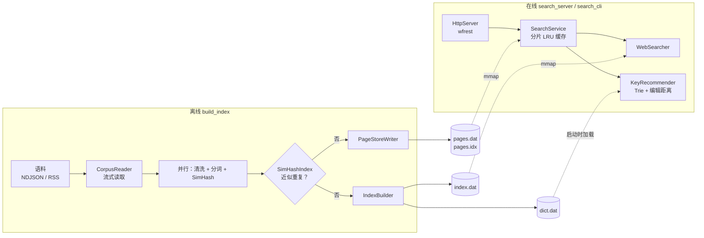
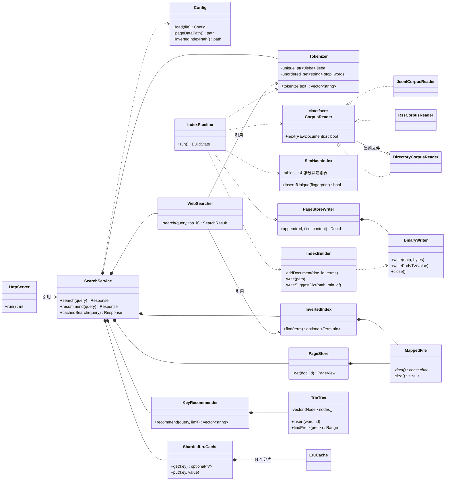
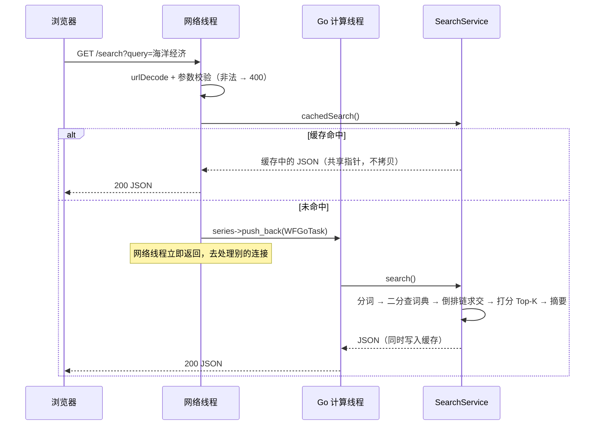

# 架构导读

这份文档回答三个问题：**系统是怎么搭起来的**、**代码应该按什么顺序读**、**原代码踩过哪些坑以及现在为什么这样写**。

---

## 1. 整体架构

### 1.1 一句话概括

离线程序把语料加工成 **4 个只读文件**；在线程序把这 4 个文件 `mmap` 进内存后直接查询。
两个程序之间唯一的耦合是磁盘文件格式（`include/search/index/IndexFormat.h`）。



### 1.2 分层与依赖方向

```
apps/      build_index        search_cli          search_server
              │                   │                    │
src/       offline ──────┐     online ◄──────────── server（唯一依赖 wfrest 的目录）
                         ▼        │
                       index ◄────┘        磁盘格式 + 读写
                         │
                       common               配置 / 日志 / UTF-8 / mmap / 分词
```

依赖只允许从上往下。`online` 不知道 HTTP 的存在，所以 `search_cli` 和单元测试可以脱离网络直接驱动全部检索逻辑；
`offline` 和 `online` 互不依赖，只通过 `index` 层定义的文件格式对话。

### 1.3 类图



`*--` 表示“拥有”（成员对象，生命周期绑定），`-->` 表示“只持有引用”（生命周期由上层保证）。
整个项目里没有一个裸 `new`/`delete`，也没有全局单例。

### 1.4 磁盘文件格式

| 文件 | 内容 | 在线端用法 |
| --- | --- | --- |
| `pages.dat` | 8 字节文件头 + 连续的记录：`{url_len, title_len, content_len}` + 三段字节 | `mmap`，`get()` 返回 `string_view` |
| `pages.idx` | `uint64 offset[doc_count]` | `mmap`，O(1) 定位第 i 篇 |
| `index.dat` | 文件头 → `TermEntry[]`（按词项排序）→ `Posting[]` → 字符串池 | `mmap`，在词典表上二分查找 |
| `dict.dat` | 文本，每行 `词 词频` | 启动时读入并构建 Trie |

所有定长结构体都用 `static_assert` 锁死了大小，文件头带 magic 和版本号，加载时做完整的越界校验——
损坏或不匹配的文件会在启动时被拒绝，而不是在某次查询时读到映射区之外。

### 1.5 一次检索请求的路径



### 1.6 规模与实测数据

以下数据来自 `scripts/gen_mock_corpus.py --docs 1000000` 生成的模拟语料（2.05 GB NDJSON，10 个分片，
其中约 5% 是人为注入的转载/近似重复），机器为 16 线程的桌面 CPU、Windows + MinGW GCC 14 Release（`-O3`）。
数字只用于说明量级，换机器会有出入。

| 指标 | 4 千篇（RSS 样例） | 100 万篇（模拟） |
| --- | --- | --- |
| 离线建库总耗时 | 1.6 s | 124 s |
| 读入 / 判重丢弃 / 入库 | 4208 / 267 / 3941 | 1,000,000 / 48,083 / 951,917 |
| 词项数 / 倒排记录数 | 9.8 万 / 92 万 | 35 万 / 1.34 亿 |
| 建库峰值内存 | — | 约 1.9 GB |
| `index.dat` / `pages.dat` | 10 MB / 12 MB | 1.04 GB / 1.74 GB |
| 在线服务启动耗时 | 约 1 s（几乎全部是加载 jieba 词典） | 约 1 s |
| 检索耗时（未命中缓存） | 0.1 ~ 0.3 ms | 稀有词中位 0.08 ms；高频词 0.5 ~ 5 ms |
| 联想耗时 | < 0.05 ms | < 0.05 ms |

几点说明：

- **去重效果**：100 万篇里注入了 49,765 篇转载，判重丢弃 48,083 篇，没有误杀（入库数 ≥ 原创数 950,235）。
  漏掉的那部分是“正文较短 + 末尾追加了署名”的转载，海明距离刚好超过阈值 3，这是 SimHash 固有的取舍。
  （100 万篇这一列测于指纹权重还是原始词频的时候。改成次线性权重 `1 + log2(tf)` 之后——原因见 3.3 第 15 条——
  转载的召回略有下降：2 万篇模拟语料里的 1,010 篇转载，原来丢弃 982 篇，现在丢弃 945 篇；
  换来的是真实语料上的误杀大幅减少，RSS 样例一列是新权重下的数字。）
- **SimHash 的局限**：它衡量的是“用词的重合度”。由同一个模板批量生成、只差一两个专有名词的小条目
  （中文维基里的法国市镇、小行星列表分页）用词几乎完全相同，会被判成重复。实测 79 万篇中文维基因此丢弃约 1.5%。
  这是算法的正常行为；要保留它们只能调小 `simhash_max_distance`。
- **启动时间与数据量无关**：索引是 `mmap` 的，1 GB 的 `index.dat` 不需要“加载”。代价是冷启动后的第一批查询要等磁盘，
  可以用 `preload_index = true` 在后台预读（实测数据见 [docs/BENCHMARK.md](docs/BENCHMARK.md) 6.5）。
- **建库内存与倒排记录数成正比**（每条 8 字节 + vector 扩容余量）。这是当前实现的规模上限所在：
  千万级文档需要改成“分段落盘 + 多路归并”（SPIMI），见 3.4 节。
- **建库的串行部分**（读文件、JSON 解析、去重、写盘）没有并行，16 线程相对单线程的整体加速比约 3.5 倍，
  继续优化的方向是把 JSON 解析也挪进并行阶段。
- 同一份语料用 1 个线程和 16 个线程建库，四个输出文件的 SHA-1 完全一致。

---

## 2. 代码阅读指南

建议**先跑起来再读**：按 README 构建后执行 `build_index` 和 `search_cli`，对输入输出有了直观印象再看代码。
每个头文件顶部都有一段注释，说明“这个类解决什么问题、原实现错在哪、现在为什么这样设计”——**头文件注释是正文，请不要跳过**。

推荐顺序（自底向上，每一步只依赖前面已经读过的东西）：

### 第 0 站：建立全局印象（10 分钟）

| 文件 | 看什么 |
| --- | --- |
| `CMakeLists.txt` | 有哪些 target、谁链接谁——这就是 1.2 节那张依赖图 |
| `conf/search.conf` | 系统有哪些可调参数 |
| `apps/build_index.cpp`、`apps/search_cli.cpp` | 两个 `main()` 各只有十几行，看清程序的“骨架” |

### 第 1 站：公共基础设施 `common/`

| 顺序 | 文件 | 学习点 |
| --- | --- | --- |
| 1 | `Utf8.h` | UTF-8 编码规则；`constexpr`；如何写“对任意脏输入都安全”的解码器 |
| 2 | `Config.h/.cpp` | 强类型配置代替字符串 map；`std::filesystem`；`std::from_chars`；fail-fast |
| 3 | `MappedFile.h/.cpp` | **RAII 的标准范例**：Rule of Five、`std::exchange` 实现移动语义；`preload()` 与 `madvise` 的坑 |
| 4 | `BinaryWriter.h/.cpp` | 成员声明顺序为什么重要；`static_assert` + `is_trivially_copyable` |
| 5 | `Tokenizer.h/.cpp` | Pimpl + 前置声明隔离重型头文件；erase-remove 惯用法 |
| 6 | `Log.h` | 折叠表达式 `(stream << ... << args)` |

### 第 2 站：磁盘格式 `index/`

| 顺序 | 文件 | 学习点 |
| --- | --- | --- |
| 7 | `IndexFormat.h` | **全项目最重要的一个文件**。读懂这几个结构体，离线和在线两半就都通了 |
| 8 | `PageStore.h/.cpp` | 长度前缀记录；`string_view` 零拷贝；为什么不对齐的数据要用 `memcpy` 读 |
| 9 | `InvertedIndex.h/.cpp` | 在 `mmap` 内存上二分查找；加载时的完整性校验；`std::optional` 做返回值 |

### 第 3 站：离线管线 `offline/`

| 顺序 | 文件 | 学习点 |
| --- | --- | --- |
| 10 | `Document.h` | 用排序 vector 代替 `std::map` 统计词频 |
| 11 | `CorpusReader.h/.cpp` | 抽象基类 + 工厂函数 + `unique_ptr`；流式（拉模式）迭代器 |
| 12 | `HtmlCleaner.cpp` | 手写单趟状态机，替换掉 `std::regex` |
| 13 | `SimHash.h/.cpp` | SimHash 原理；**抽屉原理把 O(N²) 判重降到 O(N)**（面试高频）；为什么权重要取对数 |
| 14 | `IndexBuilder.h/.cpp` | TF-IDF 与 L2 归一化；标题加权；`try_emplace`；位域；内存布局对构建规模的影响 |
| 15 | `IndexPipeline.cpp` | 把前面所有零件串起来；`parallelFor`：原子计数器抢任务、异常跨线程传递 |

读完这一站，建议自己动手把 `apps/build_index` 复现一遍。

### 第 4 站：在线检索 `online/`

| 顺序 | 文件 | 学习点 |
| --- | --- | --- |
| 16 | `LRUCache.h` | `list::splice` 实现 O(1) LRU；哈希分片降低锁竞争；模板类写在头文件；容量 0 时不加锁的快速返回 |
| 17 | `TrieTree.h/.cpp` | 用“有序区间”代替每个节点的 `set<int>`；vector 下标代替裸指针；迭代器/引用失效 |
| 18 | `KeyRecommender.h/.cpp` | 滚动数组编辑距离；固定容量 Top-K 堆；带自定义比较器的堆算法 |
| 19 | `WebSearcher.h/.cpp` | 多路有序链求交（游标 + 二分）；余弦相似度；`partial_sort`；严格弱序 |
| 20 | `SearchService.h/.cpp` | Facade；依赖注入代替单例；成员声明顺序即构造顺序；`shared_ptr<const T>` 共享只读数据；带取消标志的后台线程 |

### 第 5 站：HTTP 接入 `server/`

| 顺序 | 文件 | 学习点 |
| --- | --- | --- |
| 21 | `UrlCodec.h`（在 common 下） | 把“可能抛异常的解析”改成返回 `optional` |
| 22 | `HttpServer.h/.cpp` | Workflow 的 series/任务模型；网络线程与计算线程分离；lambda init-capture；优雅退出；`max_connections` 与 fd 上限（`setrlimit`） |

### 最后：`tests/unit_tests.cpp`

每个测试都是对应模块的“可执行文档”。自己复现某个模块时，先把对应的测试抄过去让它失败，再写实现让它通过，
是验证自己是否真的理解了的最快办法。`simhash_index_matches_brute_force` 展示了如何用暴力解法验证优化解法。

---

## 3. 常见问题与避坑指南

### 3.1 原代码中发现的问题

按严重程度分组。“位置”指原 `main` 分支中的文件。

#### A. 会导致崩溃或可被远程利用

| # | 问题 | 位置 | 后果 | 现在的做法 |
| --- | --- | --- | --- | --- |
| A1 | `uriDecode` 用 `std::stoi(hex, nullptr, 16)`，不校验输入 | `NetServer.cpp` | 请求 `/search?query=%zz` 即抛异常，异常逃出回调，**进程终止** | `urlDecode` 逐字符校验，返回 `optional`，非法输入 → 400 |
| A2 | 编辑距离用变长数组 `int dp[n+1][m+1]`，n 来自用户输入 | `KeyRecommend.cpp` | 超长 query **栈溢出**；VLA 本身也不是标准 C++ | 堆上的滚动数组，且 query 截断到 32 字符、256 字节 |
| A3 | `elem->GetText()` 可能返回 `nullptr`，直接赋给 `std::string` | `PageLib.cpp` | 遇到空标签 `<title/>` 即未定义行为（通常崩溃） | `childText()` 判空 |
| A4 | 特化 `std::less<pair<int,double>>` 等标准库类型 | `WebSearch.h`、`KeyRecommend.h` | 未定义行为；且比较器对相等元素返回 `true`，违反严格弱序 | 用 lambda 比较器，得分相同按 id 决胜 |
| A5 | 对查询串、JSON 输出、索引文件都没有任何长度/合法性校验 | 多处 | 脏语料里一个非法 UTF-8 字节就让 `json.dump()` 抛异常 | 查询限长；`dump` 用 `replace` 策略；索引加载时全量越界检查 |

#### B. 逻辑错误（结果不对）

| # | 问题 | 位置 | 现在的做法 |
| --- | --- | --- | --- |
| B1 | 偏移库**写入**的是 `{起始, 结束}`，**读取**时按 `{起始, 长度}` 解释；去重后的库又写成 `长度-1` | `PageLib.cpp` / `PageLibPreprocessor.cpp` | 只存起始偏移，长度写在记录头里，读写两端共用 `IndexFormat.h` |
| B2 | SimHash 只取 top-10 关键词算指纹，粒度太粗：4125 篇被“去重”成 1958 篇，**一半是误杀**（语料中不同的正文实际约 4040 篇） | `WebPage.cpp` | 用全部词项、按次线性词频 `1 + log2(tf)` 加权；同一语料现在 4208 → 3941 |
| B3 | 查询向量的 IDF 用写死的 `N=1, DF=1` 计算，所有词权重相同 | `WebSearch.cpp` | IDF 存进索引，查询端使用真实 IDF |
| B4 | “余弦相似度”只在查询词维度上重新计算文档模长：单词查询时所有文档得分都是 1 | `WebSearch.cpp` | 文档权重离线时已按整篇归一化，点积即余弦 |
| B5 | 伪 XML 存储靠 `find("</content>")` 解析，正文含该串就错位；内容也没有转义 | `WebPage.cpp` | 长度前缀的二进制记录，不需要任何转义 |
| B6 | 偏移量用 `int`，网页库超过 2GB 即溢出 | 多处 | `uint64_t` |
| B7 | 多词查询只要有一个词不在索引里，交集就是空的，整体无结果（搜一句话基本搜不到东西） | `WebSearch.cpp` | AND 无结果时退化为 OR |
| B8 | `main` 出错后仍 `return 0`；`printf("%ld", size_t)` | `offline/main.cpp` 等 | 返回 `EXIT_FAILURE`；类型安全的日志 |
| B9 | 离线 `main` 根本没有调用 `DictProducer`，联想词典依赖仓库里一份不知何时生成的旧文件 | `offline/main.cpp` | 词典由建库管线从同一份语料统一产出，保证“能联想到的词一定搜得到” |

#### C. 性能问题

| # | 问题 | 位置 | 复杂度变化 |
| --- | --- | --- | --- |
| C1 | `auto lib = getInvertIndexLib();` 少写一个 `&`：**每次查询深拷贝整个倒排索引两遍**，外加偏移库、词典各一遍 | `WebSearch.cpp`、`KeyRecommend.cpp` | O(索引大小) → O(1) |
| C2 | 判重时与已有全部指纹逐一比较 | `PageLibPreprocessor.cpp` | O(N²) → 近似 O(N) |
| C3 | `storeIntoInvertIndexLib()` 被放进逐文档循环里 | `PageLibPreprocessor.cpp` | 每篇文档重写一次索引文件 → 只写一次 |
| C4 | Trie 每个节点一个 `set<int>` 存所有经过它的词；查询按值返回整个 set | `TrieTree.cpp` | 内存 O(总字符数) 个树节点 → 每节点 8 字节区间 |
| C5 | 每清洗一个字段现场构造并执行 2 个 `std::regex` | `WebPage.cpp`、`PageLib.cpp` | 手写单趟扫描 |
| C6 | 索引是文本格式，启动时逐行 `istringstream` 解析进嵌套 `unordered_map` | `Dictionary.cpp` | 启动 O(索引大小) 解析 → `mmap` 即用 |
| C7 | 每篇文档被 jieba 切两次；语料被完整读写磁盘三遍；全部网页先读进内存 | 离线全流程 | 单趟流式，分词一次，并行 |
| C8 | 求交集用 `set<int>` 反复构造/转换；每次查询重新 `open` 网页库文件 | `WebSearch.cpp` | 有序数组上的游标二分；`mmap` 常驻 |
| C9 | 在 `vector` 上循环 `erase(it)` 过滤停用词 | `WebSearch.cpp` | O(n²) → erase-remove O(n) |
| C10 | jieba 词典被加载两份（分词器一份、Simhasher 内部一份） | 离线 | 只加载一份 |

#### D. 设计与工程规范

- **全局单例泛滥**：`Configuration`、`Dictionary` 被所有类在任意位置 `getInstance()`，依赖关系不可见、无法单测；
  `SplitToolCppJieba` 的构造函数里甚至写死了 `"../conf/myconf.conf"`，导致程序只能在 `bin/` 目录下启动。
- **裸指针与泄漏**：`Dictionary` 里 `new SplitToolCppJieba()` 从不释放；Trie 手写递归 `delete`。
- **头文件污染**：头文件里 `using std::string;`、`using namespace wfrest;`，以及把十几个无关头文件 include 进来。
- **状态放错位置**：`WebSearch`/`KeyRecommend` 把“一次查询的中间结果”存在成员变量里，对象不可重入。
- **仓库卫生**：`bin/`、`build/`、`.vscode/`、生成的 `*.dat` 全部入库；第三方库放在 `include/` 下与业务头文件混在一起。

### 3.2 重构时的核心设计考量

**1）为什么选 `mmap` + 定长二进制布局，而不是“启动时读进内存”？**
百万文档的倒排索引有上亿条 posting。读进 `unordered_map` 意味着上亿次 `malloc` 和数分钟的启动时间；
而定长数组 `mmap` 之后，“加载”只是建立页表映射，实际数据由内核按需换入，并且天然可被所有线程无锁共享。
代价是文件格式与机器字节序绑定（小端）——对单机部署的服务来说这是值得的交换。

**2）为什么不要单例？**
单例的问题不在“只有一个实例”，而在“谁都能随手拿到”。重构后只有 `main()` 创建对象，
并通过构造函数把依赖一层层传下去：`Config → SearchService → WebSearcher`。
好处是任何一个类都可以在测试里单独构造（见 `unit_tests.cpp` 里直接 new 一个 `KeyRecommender`）。

**3）“零拷贝”具体落在哪里？**
- 网页正文：`PageStore::get()` 返回指向映射内存的 `string_view`，直到生成摘要才拷贝那 300 字节；
- 倒排链：`PostingList` 只是 `{指针, 长度}`；
- 响应体：`shared_ptr<const string>` 在缓存与发送线程之间共享，命中缓存时不复制 JSON；
- 离线：`countTermFrequencies(vector<string>&&)`、`takeString()` 全程移动而不是拷贝。

**4）线程安全是怎么保证的？**
原则是**尽量不共享可变状态**，而不是到处加锁：
- 在线：构造完成后所有数据只读；唯一可变的是缓存，锁被限制在单个分片内，且持锁时间只有几次指针操作；
- 离线：并行阶段每个线程只写自己的输出槽位；有顺序要求的去重和写盘放在单线程阶段。

**5）为什么去重和写盘不并行？**
SimHash 判重依赖“先来后到”，并行会让结果随线程调度变化。保持串行换来的是**可复现**：
同一份语料无论用几个线程，产出的文件逐字节相同。实测瓶颈在分词（已并行），串行阶段占比很小。

**6）哪些地方故意没有做（避免过度设计）？**
- 没有做索引压缩（VByte/PForDelta）、跳表、WAND 动态剪枝——百万级用不上，却会让代码难读数倍；
- 没有做增量索引/段合并——当前是全量重建，简单可靠；
- 没有引入日志库、测试框架、依赖注入框架——各用几十行手写代码解决；
- 缓存没有做 TTL 和防击穿（single-flight）——并发未命中时会重复计算一次，结果一致，可以接受。

这些都是不错的“下一步练手题”，见 3.4。

### 3.3 复现时的注意事项（容易踩的坑）

1. **`auto` 不会推导出引用。** `auto x = obj.getBigThing();` 是拷贝，要写 `const auto& x`。这是原代码最大的性能问题（C1）的根源。
2. **成员按声明顺序构造，与初始化列表的书写顺序无关。** `BinaryWriter` 的缓冲区必须声明在 `ofstream` 前面；
   `SearchService` 里 `searcher_` 必须声明在它引用的 `tokenizer_`、`index_` 后面。开 `-Wall` 能发现写反的情况。
3. **`vector` 扩容会让所有引用和迭代器失效。** `TrieTree::insert` 里先取了 `nodes_[i]` 的引用再 `emplace_back` 就是悬垂引用——所以那里全程只用下标。
4. **range-for 不延长“临时对象的成员”的生命周期。** `for (auto& p : index.find(t)->postings)` 在 C++17 里是悬垂引用，
   这次重构的测试代码里就真实踩到了（编译器 `-Wdangling-pointer` 报了出来）。
5. **析构函数里不能报告错误。** 写文件必须显式 `close()` 并检查，否则磁盘写满时你得到的是一个静默损坏的索引。
6. **异常不能跨线程传播。** 工作线程里的异常必须用 `exception_ptr` 捕获后带回主线程，否则直接 `std::terminate`。
7. **`string_view` 不拥有内存。** 它指向的 `MappedFile`/`std::string` 必须活得比它久；跨线程、进缓存的数据一定要转成 `std::string`。
8. **离线和在线必须用同一套归一化。** 大小写、停用词、标点过滤只要有一处不一致，就会出现“明明在索引里却搜不到”。所以这些逻辑只存在于 `Tokenizer` 一处。
9. **UTF-8 不能按字节处理。** 截断摘要、计算编辑距离、Trie 的边，都要在“字符”层面操作；面对脏数据，解码器必须保证总能前进且不越界。
10. **比较器必须是严格弱序。** `comp(a, a)` 必须为 `false`；想要稳定可复现的 Top-K，就给相等的情况加一个决胜字段。
11. **Windows 上注意换行符。** 词典/语料一旦被 Git 转成 CRLF，分词结果里就会混进 `\r`。仓库用 `.gitattributes` 强制 LF。
12. **C10K 的瓶颈往往不在代码里，而在“上限”上。** epoll 让少量线程管理上万连接成为可能，但还要同时放开三道闸：
    框架的 `max_connections`（Workflow 默认 2000）、进程的 fd 上限（`ulimit -n`，默认常为 1024）、内核的 `somaxconn`。
    任何一道没放开，压测时的表现都是“连接数到某个整数就上不去”。其中 fd 上限最危险：实测它不够时，多出来的连接
    会无声地卡在内核的 accept 队列里（客户端不报错、服务端没日志）。所以 `search_server` 启动时会自己把 fd 软上限
    提到 `max_connections + 64`；硬上限也不够就拒绝启动——启动失败立刻能看到，无声卡住要到线上高峰才暴露。
    注意这一步必须早于 Workflow 的初始化：它按“初始化那一刻”的 fd 上限分配内部的 fd 表。
13. **`madvise(MADV_WILLNEED)` 不会预读整个大文件。** Linux 把单次预读量封顶在设备的 max(read_ahead_kb, max_sectors_kb)，
    测试机上对 495 MiB 的文件调用一次只读进了 0.8%，而且不报错。想把 `mmap` 的文件整个读进页缓存，
    只能分块调用，或者老老实实逐页读一遍（`MappedFile::preload` 两样都做，由后台线程执行）。
    教训：**“建议类”的系统调用一定要测效果**，它们失败或被打折扣时不会告诉你。
14. **服务默认只监听 127.0.0.1。** 对外访问交给反向代理（HTTPS、限流、访问日志），不要把业务端口直接暴露到公网。
15. **按原始词频加权的 SimHash 会被一个高频词“绑架”。** 指纹的每一位是所有词按权重投票的结果；某个词出现几十次，
    它的哈希就几乎单独决定了指纹。真实语料上的后果：足球运动员条目（成绩表里 30 个 "0"）被判成与一篇 R 语言提问重复，
    演员条目和电视剧条目因为都有几十个“饰”字被判重。100 万篇 Stack Overflow 因此误丢 6,229 篇；
    权重改成 `1 + log2(tf)` 后只丢 120 篇，抽查都是真正的重复提问。
    教训：**模拟语料测不出这类问题**——随机生成的文本里没有“一个词占全文三成”的文档，一定要用真实数据抽查被丢弃的样本。
16. **余弦相似度偏爱短文档，需要标题加权来纠正。** 文档向量按 L2 归一化，文档越长，每个词分到的权重越小。
    搜“红楼梦”，一篇 622 字、提到 14 次“红楼梦”的村庄条目会排在几万字的《红楼梦》主条目前面。
    标题是主题最可靠的信号，所以建库时给标题里的词加权（`title_weight_percent`，公式见 `IndexBuilder.h`）。
    第一版做法是“标题词频乘以常数”，实测 ×3、×5、×10 都几乎无效：长文档里这个词本来就出现几百次，多算几次无关痛痒，
    受益的反而是标题里含这个词的短文。有效的做法是让加的权重**与文档向量的模长成比例**，这样才与文档长度无关。
    这仍然只是最小的修正，不是完整的解法：BM25 的长度归一化才是针对这个问题设计的（见 3.4）。

### 3.4 可以继续做的练习

由易到难：给 `/search` 加分页参数 → 给缓存加 TTL → 用 single-flight 消除并发未命中的重复计算 →
倒排链 VByte 压缩 → 离线构建改成分段落盘再多路归并（SPIMI，突破内存上限）→ BM25 打分 → 增量索引。
